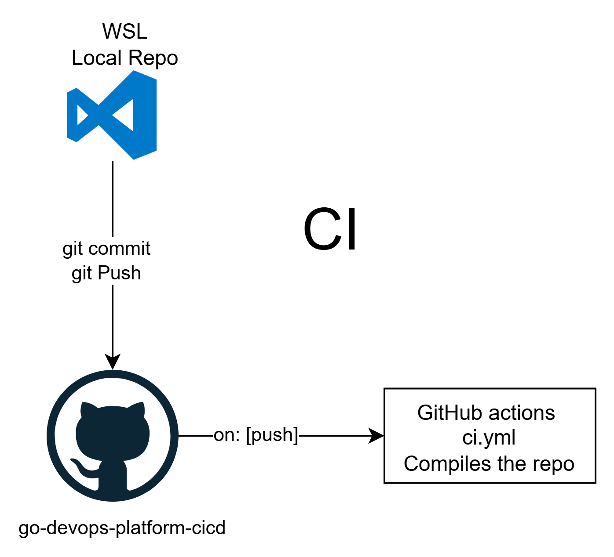

+++
title = "Building a Continuous Integration Pipeline with GitHub Actions -- Project 2 (Part 1)"
tags = ["DevOps", "Go","Github Actions"]
date = "2026-07-23"
+++

> **Series:** DevOps Project Series\
> **Part:** 1 of 2\
> **GitHub Repo:** https://github.com/khatri11-cloud/go-devops-platform-cicd\


## Introduction

In the previous project, I built a production-ready Go web application, containerized it with Docker, and deployed it to Microsoft Azure using Terraform. While the deployment was successful, the workflow was entirely manual.

Whenever I made even a small change to the application, I had to repeat the same sequence of steps:

- Build the Go application
- Build a new Docker image
- Push the image to Azure Container Registry (ACR)
- Redeploy the Azure Container Instance (ACI)
- Verify that the application was running correctly

Although this approach worked, it quickly became repetitive and error-prone. More importantly, it wasn't how software is delivered in production environments.

The next logical step was to automate this process.

In this project, I begin transforming the application into a continuously delivered service by building a complete CI/CD pipeline using GitHub Actions. Part 1 focuses on Continuous Integration (CI), ensuring that every code change is automatically validated before it is considered ready for deployment.


# Project Overview

The development workflow now consists of both a local and a cloud environment.

- The Go application is developed locally inside **WSL (Windows Subsystem for Linux)**.
- The source code is stored in a [**GitHub repository**.](https://github.com/khatri11-cloud/go-devops-platform-cicd)
- GitHub Actions provides the automation platform for Continuous Integration.
- Docker and Microsoft Azure will be used later in the deployment stage of the pipeline.



The objective is simple:

> Every change pushed to the GitHub repository should automatically build and validate the application without requiring any manual intervention.
> 


# Why Continuous Integration?

Before introducing automation, every code change required me to manually verify whether the application still compiled correctly.

As the project grows, this approach becomes increasingly unreliable.

Continuous Integration solves this problem by automatically performing a series of validation steps whenever new code is pushed to the repository.

Instead of discovering mistakes during deployment, they are detected immediately after each commit.

This provides rapid feedback and ensures that the main branch always remains in a deployable state.


# Creating the GitHub Actions Workflow

GitHub automatically looks for workflow definitions inside the following directory:

```
.github/workflows/
```

Within this directory, I created a workflow file named:

```
ci.yml
```

This file defines the Continuous Integration pipeline that GitHub Actions executes whenever code is pushed to the repository or a pull request is opened.


*Repository structure highlighting `.github/workflows/ci.yml`*


# The CI Workflow

The complete workflow is shown below.

```
name: Continuous Integration

on:
  push:
    branches:
      - main

  pull_request:
    branches:
      - main

jobs:
  build-and-test:
    name: Build and Test

    runs-on: ubuntu-latest

    defaults:
      run:
        working-directory: app

    steps:
      - name: Checkout Repository
        uses: actions/checkout@v4

      - name: Setup Go
        uses: actions/setup-go@v5
        with:
          go-version-file: app/go.mod

      - name: Download Dependencies
        run: go mod download

      - name: Verify Formatting
        run: gofmt -l .

      - name: Run Go Vet
        run: go vet ./...

      - name: Run Tests
        run: go test ./...

      - name: Build Application
        run: go build ./...
```


# Understanding the Workflow

Although the workflow consists of only a few steps, each one plays an important role in validating the application.

### Trigger Events

```
on:
  push:
  pull_request:
```

The workflow is triggered whenever code is pushed to the `main` branch or when a pull request targets the `main` branch.

This ensures that all incoming changes are automatically validated.


### Checkout Repository

```
uses: actions/checkout@v4
```

GitHub Actions starts with a clean virtual machine.

This step downloads the latest version of the repository so the remaining workflow can access the project files.


### Setup Go

```
uses: actions/setup-go@v5
```

The workflow installs the Go version defined by the project.

This guarantees that the application is built using the same Go version regardless of where the workflow executes.


### Download Dependencies

```
go mod download
```

Any required Go modules are downloaded before the project is compiled.

Although this project currently has very few dependencies, including this step makes the workflow ready for future expansion.


### Verify Formatting

```
gofmt -l .
```

Before compiling the application, GitHub checks whether the source code follows Go's standard formatting rules.

Maintaining consistent formatting improves readability and keeps the codebase consistent across contributors.


### Static Analysis

```
go vet ./...
```

`go vet` performs static analysis on the source code.

Unlike the compiler, it looks for suspicious constructs and common programming mistakes that may still compile successfully but could cause unexpected behavior.


### Unit Testing

```
go test ./...
```

The workflow executes the project's unit tests to ensure that existing functionality continues to behave as expected.

As additional features are introduced in future projects, this testing stage will become increasingly important.


### Build Verification

```
go build ./...
```

The final step compiles the application.

If compilation succeeds, GitHub confirms that the project is in a buildable state.


# Verifying the Pipeline

To verify that the pipeline was functioning correctly, I intentionally introduced errors into the application.

For example, I temporarily removed a closing brace from `main.go`, causing the application to fail compilation.

After committing and pushing the change, GitHub Actions automatically executed the workflow.

As expected, the build failed during the compilation stage.

Once the syntax error was corrected and the changes were pushed again, the workflow completed successfully.

This simple test demonstrated that the pipeline was correctly validating every change before it could be considered ready for deployment.


*Multiple GitHub Actions workflow runs showing both failed and successful executions.*


# What Has Been Achieved?

At this stage, the project now supports Continuous Integration.

Every push to the repository automatically:

- Checks out the latest source code
- Configures the Go environment
- Downloads project dependencies
- Verifies code formatting
- Performs static analysis
- Executes unit tests
- Builds the application

Developers no longer need to manually verify that the application compiles after every change. GitHub Actions now performs these checks automatically.


# Looking Ahead

Although the application is now automatically validated, it still is **not automatically deployed**.

After a successful workflow run, I would still need to:

- Build a Docker image
- Push it to Azure Container Registry
- Redeploy the Azure Container Instance

These manual deployment steps are exactly what Continuous Deployment is designed to eliminate.

In the next part of this series, I will extend this workflow to build Docker images automatically, publish them to Azure Container Registry, and deploy the updated application to Azure whenever changes are pushed to the repository.

By the end of Part 2, a simple `git push` will not only validate the application but also update the running service in the cloud without requiring any manual deployment steps.