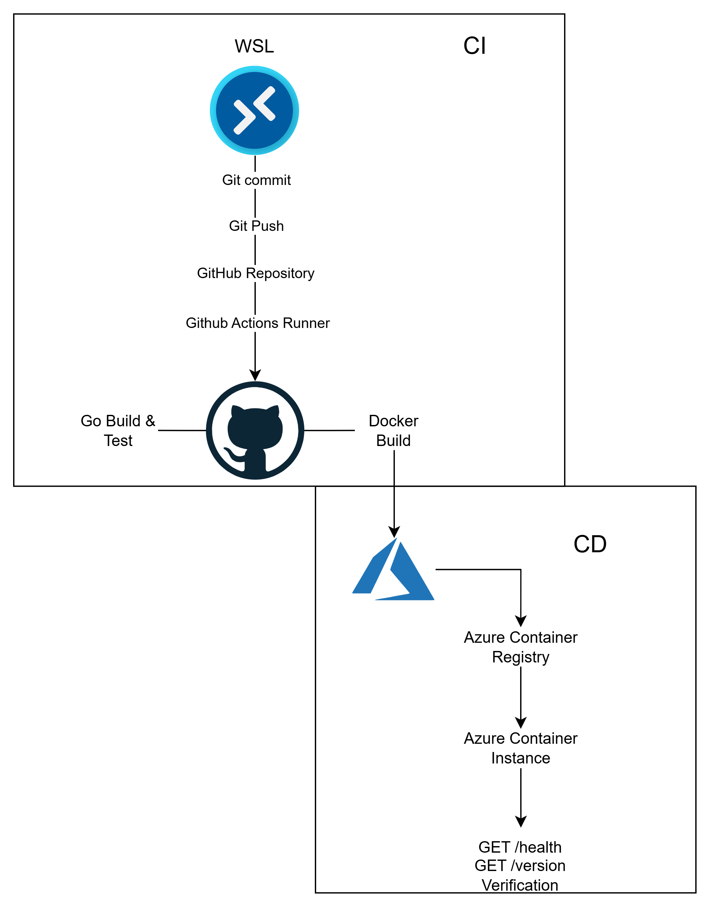

+++
title = "Building a Complete CI/CD Pipeline with GitHub Actions and Azure -- Project 2 (Part 2)"
tags = ["DevOps", "Go","Github Actions","Azure","CI/CD"]
date = "2026-07-27"
+++

> **Series:** DevOps Project Series\
> **Part:** 2 of 2


In the previous part of this series, I built the Continuous Integration (CI) pipeline for my Go application. Every push to the `main` branch automatically triggered GitHub Actions to verify formatting, run static analysis, execute unit tests, and build the application.

While this improved code quality, deployment was still a manual process.

Every change required rebuilding the Docker image, pushing it to Azure Container Registry, and manually updating the Azure Container Instance. The application itself had become easy to modify, but releasing those changes remained repetitive and error-prone.

In this article, I automate that entire deployment process and complete the CI/CD pipeline.

# The Deployment Problem

At the end of Project 1, my deployment workflow looked like this:

```
Modify Go Application
        │
        ▼
Compile Application
        │
        ▼
Build Docker Image
        │
        ▼
Push Image to Azure Container Registry
        │
        ▼
Update Azure Container Instance
        │
        ▼
Verify Deployment
```

Although these steps were straightforward, they had to be executed manually every time the application changed.

Besides consuming time, manual deployments introduce unnecessary risk. Forgetting a step, deploying the wrong image, or accidentally skipping verification can all lead to inconsistent environments.

The obvious next improvement was to automate the deployment pipeline.

# Designing the Deployment Pipeline

Since the CI workflow already verified that every commit could successfully build and pass testing, I decided that deployment should only occur after CI completed successfully.

Instead of creating a single workflow responsible for everything, I separated the responsibilities into two workflows.

The first workflow focuses entirely on Continuous Integration.

The second workflow performs Continuous Deployment.

This separation makes each workflow easier to understand, easier to debug, and closely follows how production engineering teams organize CI/CD pipelines.



# Continuous Deployment Workflow

The deployment workflow is triggered automatically whenever the Continuous Integration workflow completes successfully.

```yaml
on:
  workflow_run:
    workflows: ["Continuous Integration"]
    types:
      - completed
```

This prevents deployments from occurring when compilation or testing fails.

Only validated code is allowed to reach the deployment stage.

# Authenticating with Azure

GitHub Actions executes inside temporary virtual machines.

Unlike my local development environment, these runners have no knowledge of my Azure subscription.

To allow GitHub Actions to deploy resources securely, I created an Azure Service Principal and stored its credentials as encrypted GitHub Repository Secrets.

The deployment workflow authenticates using these credentials before interacting with Azure resources.


---

# Repository Variables

Not every configuration value is sensitive.

Values such as the Azure Resource Group, Container Instance name, DNS label, and Azure region are configuration rather than secrets.

Instead of hardcoding these values inside the workflow, I stored them as GitHub Repository Variables.

This keeps the workflow reusable while separating confidential credentials from deployment configuration.


---

# Building and Publishing Docker Images

Once authenticated, GitHub Actions builds the Docker image and pushes it to Azure Container Registry.

Initially, I only used the `latest` tag.

Although simple, this approach makes it impossible to identify exactly which source code version is currently deployed.

To improve traceability, the workflow now creates two tags for every build.

- `latest`
- Git Commit SHA

The commit SHA provides an immutable reference to the exact source code that produced the image, while the `latest` tag remains convenient for development.


# Automating Deployment

Azure Container Instances do not automatically redeploy when a new Docker image is pushed to Azure Container Registry.

Because of this, the deployment workflow performs three actions.

1. Delete the existing container.
2. Create a new container using the newly built Docker image.
3. Verify that the application is running correctly.

Although deleting and recreating the container introduces a brief period of downtime, it keeps the deployment process simple and is perfectly suitable for this project.

Future projects using Kubernetes will replace this strategy with rolling updates that avoid service interruption.

# Health Verification

Originally, I waited for a fixed amount of time before checking whether the application was available.

This approach worked, but it wasn't particularly reliable.

If the application started quickly, time was wasted waiting.

If the application started slowly, the deployment could fail even though everything was functioning correctly.

I replaced the fixed delay with an automated health check that repeatedly calls the `/health` endpoint until the application becomes available or the deployment times out.

This creates a more resilient deployment process.


**Deployment Successful Summary**

| **tem** | **Value** |
| --- | --- |
| **Repository** | `khatri11-cloud/go-devops-platform-cicd` |
| **Branch** | `main` |
| **Commit** | `9f4ef60bc753aa2c519be6b92ca7167f24fe0232` |
| **Image** | `***/devops-platform:9f4ef60bc753aa2c519be6b92ca7167f24fe0232` |
| **Environment** | Azure Container Instance |
| **URL** | [http://prajwal-devops-platform.eastus.azurecontainer.io:8080](http://prajwal-devops-platform.eastus.azurecontainer.io:8080/) |

# Problems Encountered

Like most engineering projects, the pipeline was not completed without mistakes.

Some of the issues I encountered included:

- Forgetting to save the workflow file before pushing, resulting in GitHub Actions reporting **"No event triggers defined in `on`"**.
- Initial authentication failures caused by an incorrectly configured Azure Service Principal.
- Learning the difference between GitHub Repository Secrets and Repository Variables.
- Discovering that pushing a Docker image to Azure Container Registry does **not** automatically update Azure Container Instances.
- Replacing mutable Docker tags with immutable Git commit SHA tags for better deployment traceability.

Although these issues slowed development, resolving them improved my understanding of both GitHub Actions and Azure deployment workflows.

# Comparing Project 1 and Project 2

Project 1 demonstrated how to manually deploy a containerized Go application into Azure.

Project 2 transformed that manual process into a fully automated deployment pipeline.

The deployment process now follows this sequence.

```
Developer
      │
      ▼
Git Push
      │
      ▼
Continuous Integration
      │
      ├── Formatting
      ├── Static Analysis
      ├── Unit Tests
      └── Build
      │
      ▼
Continuous Deployment
      │
      ├── Azure Login
      ├── Docker Build
      ├── Push to Azure Container Registry
      ├── Delete Existing Container
      ├── Deploy Updated Container
      └── Health Verification
      │
      ▼
Application Updated Automatically
```

The entire release process now happens automatically after every successful commit.

No manual Docker commands.

No manual Azure deployment.

No manual verification.

# Looking Ahead

Although this pipeline is already capable of automatically deploying every successful commit, it is still relatively simple.

The deployment currently replaces the running container by deleting and recreating it.

In the next project, I plan to introduce application monitoring using Prometheus and Grafana to gain visibility into application health, performance metrics, and deployment behaviour.

As the portfolio evolves, later projects will replace Azure Container Instances with Kubernetes, enabling rolling deployments, self-healing workloads, and GitOps-based delivery.

Automation solved the deployment problem.

The next challenge is making that deployment observable.